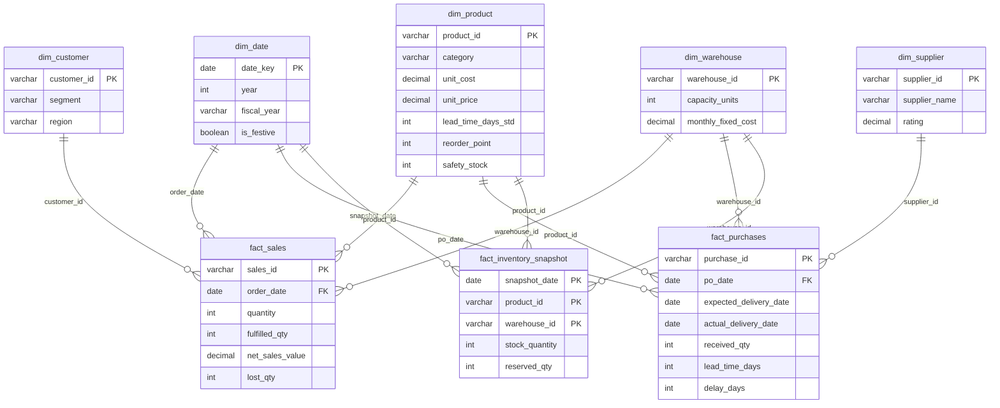

# Supply Chain & Inventory Optimization Using Data Warehousing and Business Intelligence

**Power BI · Python · SQL (DuckDB) · Power Query · DAX**

> ## ⚠️ Synthetic data
> All data in this project is **synthetic**. It was generated by `scripts/generate_data.py` (seed 42) for a *fictional* Indian
> distributor: INR, 6 warehouses, 400 products, 40 suppliers, ~2,000 customers, **Jan 2024 – Sep 2026**.
> Business patterns (chronic stockouts, slow suppliers, obsolete stock pushed to two hubs, festive seasonality) and
> data-quality problems were planted on purpose so the pipeline has something real to find and fix
> (`data/embedded_patterns_answer_key.csv`). No real company, customer or supplier is represented. Every number below
> describes this synthetic dataset; it demonstrates the method, not real business performance.

---

## 1. Business problem

A multi-warehouse distributor suffers from **overstocking, stock shortages, delayed supplier deliveries, inefficient
inventory management and poor demand visibility**. Management wants one trusted view of stock, demand and suppliers.

| # | Business question | Answered by |
|---|---|---|
| 1 | Which products frequently go out of stock? | SQL Q05, page 5, notebook §7 |
| 2 | Which warehouse has the highest inventory? | SQL Q06/Q07, pages 1–2, notebook §5 |
| 3 | Which suppliers have longer delivery times? | SQL Q11/Q12, page 3, notebook §9 |
| 4 | Which products have high demand? | SQL Q03/Q04/Q20, page 4, notebook §4/§6 |
| 5 | Where is excess inventory accumulating? | SQL Q08/Q09/Q10, pages 1 & 5, notebook §8 |
| 6 | How can we reduce inventory holding costs? | SQL Q13/Q14/Q21, pages 1 & 5 (what-if), notebook §10 |
| 7 | Which products need restocking? | SQL Q15, page 5 restock table, notebook §11 |

## 2. Architecture

```
data/raw/*.csv ──► src/data_cleaning.py ──► data/processed/*.csv (+ data_quality_log.csv)
 (generate_data.py)        (Python/pandas)              │
                                                       ├──► scripts/build_warehouse.py ──► warehouse/supply_chain.duckdb
                                                       │        (star schema, PK/FK)        └► sql/03_analysis_queries.sql (21 queries)
                                                       │                                         scripts/run_sql.py → outputs/sql_results/
                                                       ├──► notebooks/01_EDA.ipynb (EDA, ABC/XYZ, charts → images/)
                                                       └──► Power Query (pbip/…SemanticModel) ──► DAX model ──► Power BI report (PBIP)
```

Cleaning happens **once** in Python; the SQL warehouse and Power BI both read `data/processed/`, so the numbers agree.

## 3. Dataset and data-quality issues

| File (processed) | Rows | Grain |
|---|---:|---|
| products.csv | 400 | product (category, cost/price, lead time, reorder point, safety stock, shelf life) |
| suppliers.csv | 40 | supplier (city, state, rating, payment terms) |
| customers.csv | 2,001 | customer (segment, city, state, region) + `C00000` Unknown |
| warehouses.csv | 6 | warehouse (capacity units, monthly fixed cost) |
| sales.csv | 152,291 | sales order line (ordered vs fulfilled qty, discount, status, ship/delivery dates) |
| purchases.csv | 22,750 | purchase order (expected vs actual delivery, received qty, status) |
| inventory.csv | 343,200 | weekly (Sunday) stock snapshot per product × warehouse |

Problems planted in `data/raw` and fixed by `src/data_cleaning.py` (56 logged checks, 60.5k rows/cells touched — see
`data/processed/data_quality_log.csv`):

- exact duplicate rows (900 sales, 120 purchases, 400 inventory) and duplicate business keys
- mixed date formats (ISO, DD/MM/YYYY, DD-Mon-YYYY) parsed explicitly, written as ISO
- inconsistent casing / extra spaces in categorical text (3,219 order statuses, cities, categories)
- `'NA'` text instead of nulls (discount, actual delivery date, reserved qty, shelf life)
- negative quantities (sign errors), ×100 keying errors on delivered lines, purchase unit costs > 10× the product median
- 150 sales with missing customer → mapped to `C00000 Unknown` so revenue is kept
- missing unit cost imputed from category markup; missing state inferred from city
- negative stock snapshots interpolated from neighbouring weeks; FK checks for every fact table

## 4. Star schema (DuckDB warehouse and Power BI model)



Assumptions are stored in one `config` table: **holding cost 20 %/yr of inventory value** (capital 10 % + storage/handling
5 % + obsolescence/shrinkage 5 %), excess = stock above **90 days of cover**, dead stock = **no sale for 180 days**, review
period 30 days.

## 5. SQL analysis (`sql/03_analysis_queries.sql`, DuckDB) — 21 queries, all passing

| Q | Question / technique |
|---|---|
| Q01 | Row counts and date coverage (health check) |
| Q02 | Monthly sales, MoM growth (**LAG**), YTD **running total** |
| Q03 | Top-20 products by demand, **RANK**, % of total |
| Q04 | **ABC** classification (cumulative revenue share) + **NTILE** deciles |
| Q05 | Stockout frequency (weeks out of stock), lost units / sales, fill rate |
| Q06 | Inventory by warehouse: units, value, capacity utilisation, rank |
| Q07 | Month-end inventory value by warehouse with change vs previous month (LAG) |
| Q08 | **Days of cover** per product × warehouse + cover band |
| Q09 | Excess inventory (> 90 days cover) by warehouse × category, holding cost of excess |
| Q10 | Dead stock (no sale in 180+ days) |
| Q11 | Supplier lead time, **lead-time std dev**, delay, on-time, in-full, **OTIF** |
| Q12 | Supplier lead-time trend by quarter (LAG), worst 4 suppliers |
| Q13 | **Inventory turnover** and days inventory outstanding by category |
| Q14 | **Holding cost** (20 %/yr) + fixed cost per unit shipped by warehouse |
| Q15 | **Reorder recommendations**: available ≤ reorder point → suggested qty & priority |
| Q16 | Fill rate by warehouse and year, YoY change |
| Q17 | Sales vs purchases per month with cumulative gap |
| Q18 | Seasonality: units per day by calendar month |
| Q19 | Customer segment mix |
| Q20 | **ABC × XYZ** matrix (coefficient of variation of monthly demand) |
| Q21 | Holding-cost saving if stock is trimmed to 60 days cover + safety stock |

## 6. Power Query (`powerquery/*.pq`, identical to the PBIP partitions)

`DataFolder` parameter (default `C:\PBI\Supply_Chain_Inventory_Optimization\data\processed\`) → `Csv.Document` →
promote headers → blank → null for optional columns → **typed with culture en-US** (safe on any regional setting) → rename
`_` to spaces → model columns: Product label, unit margin %, perishable flag; supplier rating band; warehouse short name;
sales net value, demand qty, lost qty, delivery days; purchase PO value, received value, lead time, delay, on-time / in-full /
OTIF / short flags, open qty; inventory available qty and stockout flag. `Date` is generated from `DateStart`/`DateEnd`
(Jan 2024 – Dec 2026) with Indian fiscal year and season columns, and is **marked as the date table**; auto date/time is off.

## 7. DAX (`dax/measures.dax`, 101 measures + calc columns + parameters)

Display folders: **Settings** (holding cost %, thresholds, data-as-of) · **Inventory** (closing stock units/value —
semi-additive on the last snapshot, capacity utilisation, days of cover, stockout rate, inventory turnover, DIO, sell-through)
· **Overstock & holding cost** (excess units/value, dead stock, annual holding cost, excess holding cost) · **Restock** (ROP,
on-order, needs-restock flag/count, suggested reorder qty/value, priority) · **Sales** (net sales, units demanded/sold, lost
units/sales, fill rate, COGS, gross margin, PY/YoY/MoM/YTD, demand rank) · **Purchasing & suppliers** (PO value, on-time,
in-full, OTIF, short delivery, lead time + std dev, delay, delay rank) · **Titles & colours** (dynamic titles, conditional
formatting colour measures).

Extra model objects: `Product[ABC Class]` calculated column · **calculation group** `Time Intelligence` (Current, PY, YoY,
YoY %, MoM, MoM %, YTD, FYTD, Rolling 3M) · **field parameter** `Metric Selector` (8 metrics) · **what-if parameter**
`Holding Cost Rate` (10 %–35 %, default 20 %) that drives every holding-cost measure · `Date Hierarchy` (Year › Quarter ›
Month › Date).

## 8. Dashboard (PBIP: `pbip/SupplyChain.pbip`)

| Page | Answers | Main visuals |
|---|---|---|
| 1 Inventory Overview | Q2, Q5, Q6 | 6 KPI cards (stock value/units, days of cover, turnover, fill rate, overstock, holding cost), stock-value trend with **date drill-down**, warehouse donut (tooltip page), category excess and stockout charts, about-data box, **what-if holding-cost slider** |
| 2 Warehouse Performance | Q2 | capacity utilisation, stock value by hub, trend by hub, warehouse table with **colour rules + data bars** |
| 3 Supplier Performance | Q3 | OTIF / on-time / lead-time cards, delay ranking, lead time vs on-time scatter, quoted vs actual lead time trend, supplier scorecard with colour rules |
| 4 Sales & Purchase Analysis | Q4 | sales KPIs, **field-parameter metric switcher** trend (YoY by month), COGS vs received, **Top-10** product table, segment donut, **calculation-group** matrix |
| 5 Stock Shortage & Overstock | Q1, Q5, Q7 | stockout / lost sales / restock KPIs, **Top-10** lost-sales products, overstock & dead stock by hub, category × hub matrix, **restock recommendations table** (priority colours, data bars) |
| Product Detail (drill-through) | any product | stock by week per hub, demand vs sold, hub table, supplier table, Back button |
| Warehouse Tooltip | hover a hub | stock value, cover, capacity, fill rate |

**Interactivity:** left navigation rail on every main page (page-navigation buttons, current page highlighted) · synced
Date / Warehouse / Category / Supplier slicers (+ one page-specific slicer) · **Clear slicers** button · **Reset view** and
**Help overlay** bookmarks · drill-through from any product visual · report-page tooltip · Top-N filters · conditional
formatting · date hierarchy drill-down · field parameter · calculation group · what-if parameter.
Wireframe: [`docs/dashboard_wireframe.md`](docs/dashboard_wireframe.md).

## 9. Key insights (synthetic data, from `notebooks/01_EDA.ipynb` and the SQL runs)

1. **Demand** — INR **190 Cr** net sales (63.7 Cr 2024, 71.2 Cr 2025, 55.1 Cr Jan–Sep 2026). Oct–Nov festive demand is
   **~52 % higher** per day than other months. **66 products (16.5 %) make 80 % of revenue**; A-class products with stable
   (X) demand alone are 58 % of 12-month revenue.
2. **Stockouts** — Urban Paper S498 (P0007) was out of stock in **43 % of weeks** (fill rate 52 %); Agni Small Appliances
   M220 (P0254) lost INR 5.4 Cr of sales. **11 of the top-15** stockout products are the planted chronic-stockout items and
   most are bought from the two slowest suppliers. Network fill rate is **87.9 %**.
3. **Highest inventory** — **Kolkata Hub (Dankuni)** INR 3.28 Cr and **Chennai Hub (Sriperumbudur)** INR 3.24 Cr; both grew
   from ~2.2 Cr in 2024 while the other four hubs stayed at ~2 Cr. Mumbai is the fullest hub (89.6 % of capacity).
4. **Slow suppliers** — Unity Suppliers (avg lead time 26.4 days, std dev 17.2, **OTIF 10.9 %**) and Ganesh Supply Chain LLP
   (22.2 days, OTIF 6.9 %); good suppliers deliver in 7–10 days with OTIF ≈ 90 %.
5. **Excess** — concentrated in Kolkata and Chennai Home & Kitchen (INR 1.06 Cr and 1.03 Cr above 90-day cover), then
   Electronics and Furniture; **335 dead-stock rows worth INR 3.53 Cr**. Home & Kitchen turns only 2.45×/yr (149 days DIO).
6. **Holding cost** — about **INR 2.71 Cr/yr** carrying cost at 20 %. Trimming to 60 days cover + safety stock releases
   **INR 5.65 Cr** of stock and saves **≈ INR 1.13 Cr/yr**, two thirds of it in Kolkata and Chennai.
7. **Restock now** — **339** product × warehouse rows at/below reorder point: **81 urgent** (stocked out), 138 below safety
   stock, 120 below ROP; suggested orders ≈ INR 1.10 Cr.

## 10. Recommendations

1. Dual-source or renegotiate the chronic-stockout SKUs bought from Unity Suppliers / Ganesh Supply Chain LLP; include
   lead-time variability (not just average) in safety stock.
2. Stop replenishing obsolete SKUs; liquidate or transfer the dead stock in Kolkata and Chennai.
3. Set service levels by ABC-XYZ class (high for AX/AY, low for C items) instead of one reorder rule.
4. Build festive stock from August so October demand is not met by emergency POs.
5. Run the restock table weekly (urgent first) and track OTIF in supplier reviews.

## 11. Weak points / limitations

- Data is synthetic; patterns were planted, so findings are "too clean" compared with real data.
- Inventory is a weekly snapshot — intra-week stockouts are invisible; stockout rate is "weeks out of stock".
- Demand for stocked-out items is approximated by ordered quantity (no true lost-demand signal).
- Holding-cost rate (20 %) and thresholds are assumptions (the what-if slider shows sensitivity).
- Reorder logic is a simple (s, S)-style rule with 90-day average demand, no forecasting.
- The PBIP (TMDL + PBIR) was generated and schema-validated on Linux; it has not been opened in Power BI Desktop by the
  author — see `pbip/OPEN_ME_FIRST.md` for first-open checks.
- The Supplier slicer only filters purchase measures (Supplier relates to Purchases only).

## 12. Resume bullets

- Built an end-to-end supply-chain BI solution (Python cleaning → DuckDB star schema with PK/FK → 21 SQL analyses → Power BI
  PBIP) over 520k synthetic sales, purchase and weekly inventory records for 6 warehouses.
- Wrote 100+ DAX measures (semi-additive stock, days of cover, OTIF, turnover, reorder quantity), a time-intelligence
  calculation group, field parameter and what-if holding-cost parameter across a 5-page interactive dashboard with drill-through,
  tooltips, bookmarks and synced slicers.
- Identified INR 5.65 Cr of releasable excess stock (≈ INR 1.13 Cr/yr holding-cost saving), 339 restock actions and two
  suppliers with < 11 % OTIF driving chronic stockouts.

## 13. How to run

### Windows
```bat
:: 1. copy the folder to C:\PBI\Supply_Chain_Inventory_Optimization
setup_windows.bat            :: creates .venv (py -3), installs requirements, registers the Jupyter kernel
run_notebook_windows.bat     :: cleaning -> warehouse + 21 queries -> run_sql -> executes notebooks\01_EDA.ipynb
:: 2. open pbip\SupplyChain.pbip in Power BI Desktop, check the DataFolder parameter, Refresh (see pbip\OPEN_ME_FIRST.md)
```

### Linux / macOS
```bash
python3 -m venv .venv && source .venv/bin/activate
pip install -r requirements.txt
python src/data_cleaning.py          # raw -> processed (+ data_quality_log.csv)
python scripts/build_warehouse.py    # DuckDB star schema + tests every query
python scripts/run_sql.py            # prints and saves every query result to outputs/sql_results/
jupyter nbconvert --to notebook --execute --inplace notebooks/01_EDA.ipynb
# optional: python scripts/generate_data.py   (regenerates data/raw from seed 42)
```

## Project structure

```
data/raw, data/processed     CSV files (synthetic) + data_quality_log.csv + embedded_patterns_answer_key.csv
scripts/                     generate_data.py, build_warehouse.py, run_sql.py
src/data_cleaning.py         all cleaning rules
sql/                         01_create_database.sql, 02_create_tables.sql, 03_analysis_queries.sql
warehouse/                   supply_chain.duckdb (built locally, git-ignored)
notebooks/01_EDA.ipynb       executed EDA notebook
images/                      charts saved by the notebook
outputs/sql_results/         CSV result of each SQL query
powerquery/, dax/            M and DAX source (mirrors the PBIP)
pbip/                        Power BI Project (SemanticModel TMDL + Report PBIR) + OPEN_ME_FIRST.md
docs/dashboard_wireframe.md  page layouts
```
